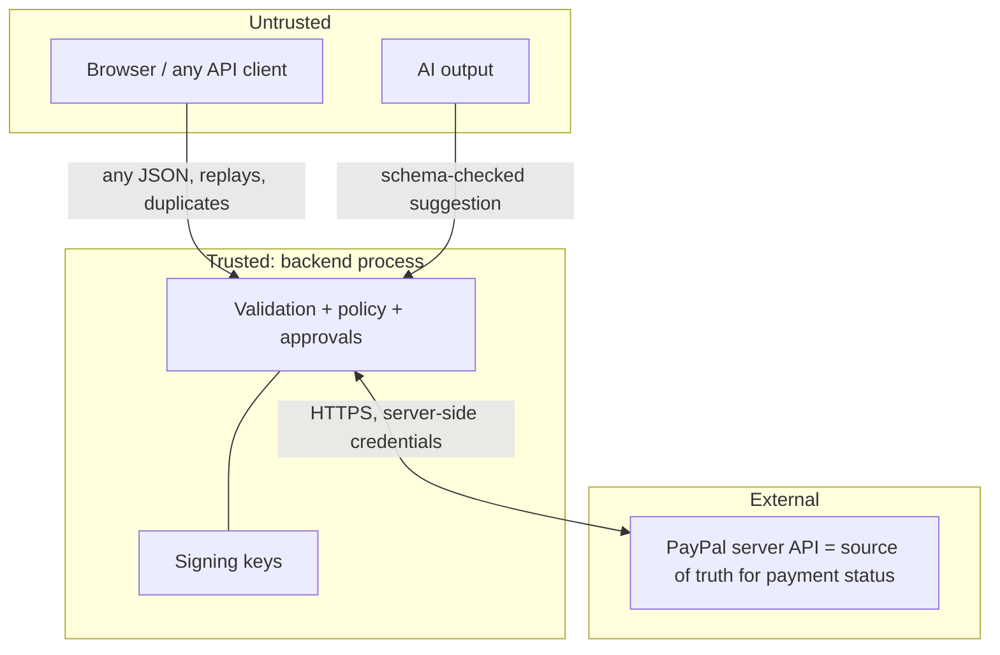
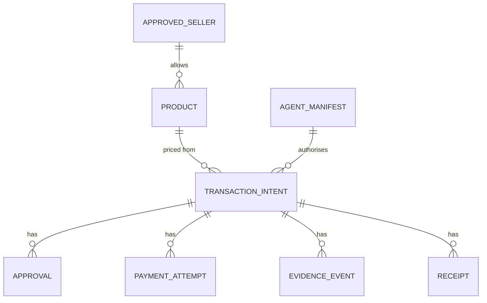
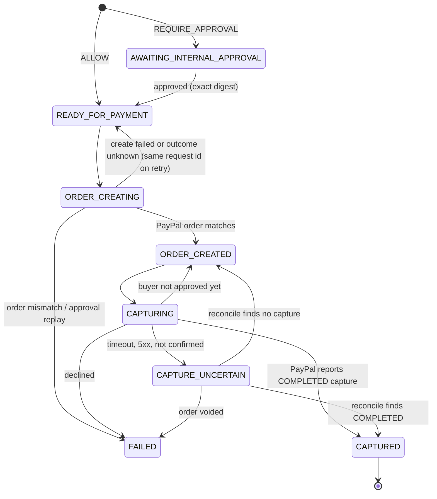
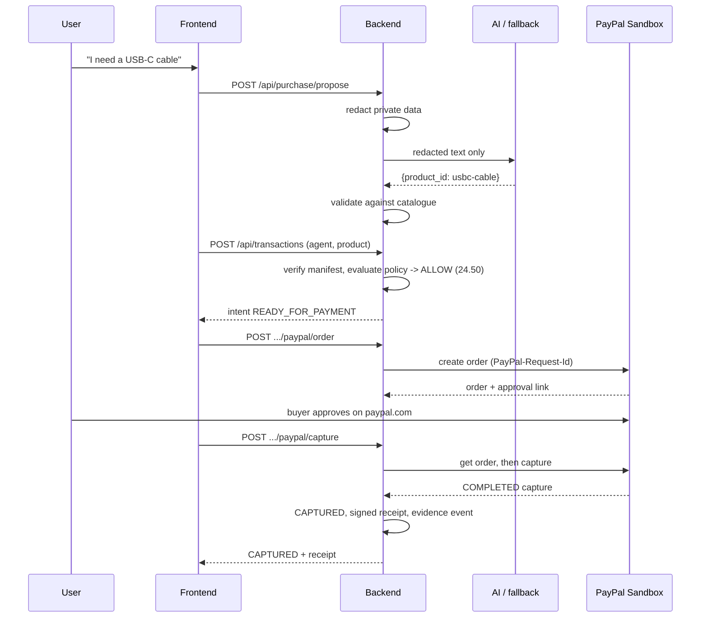
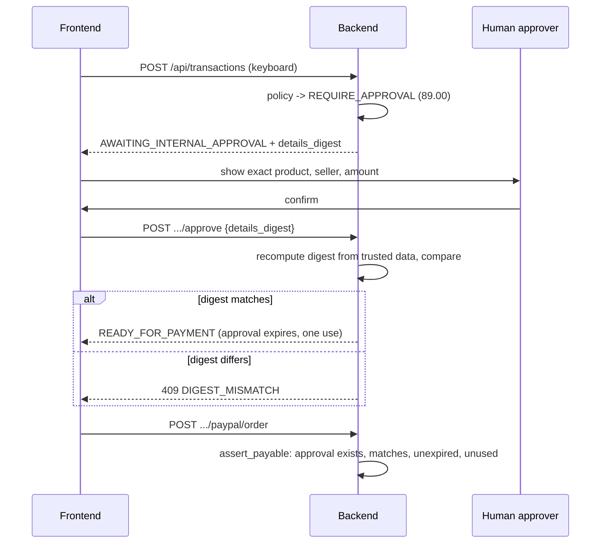
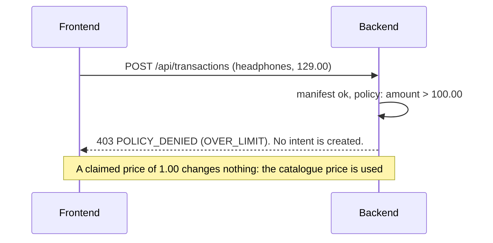
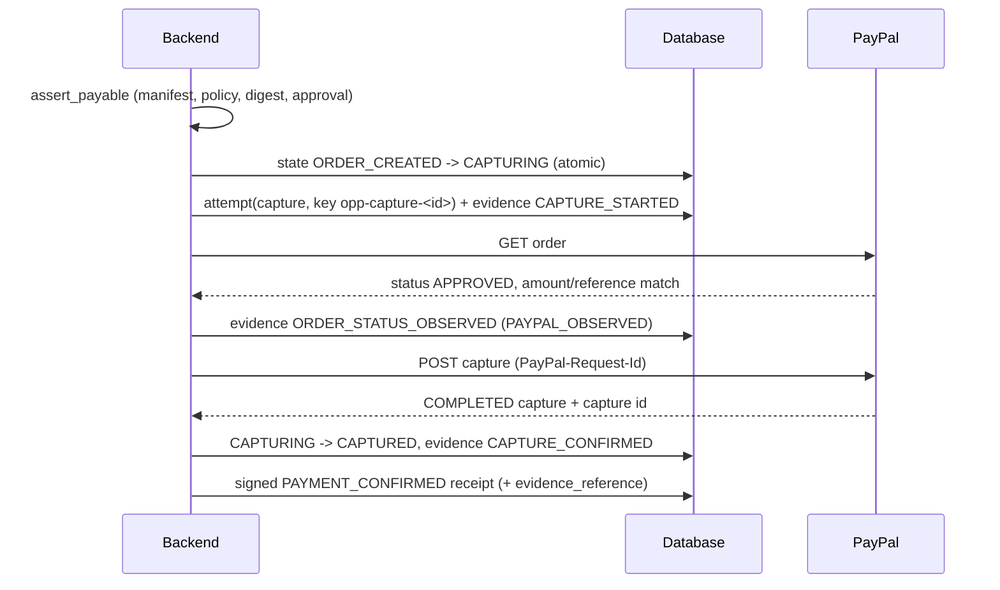
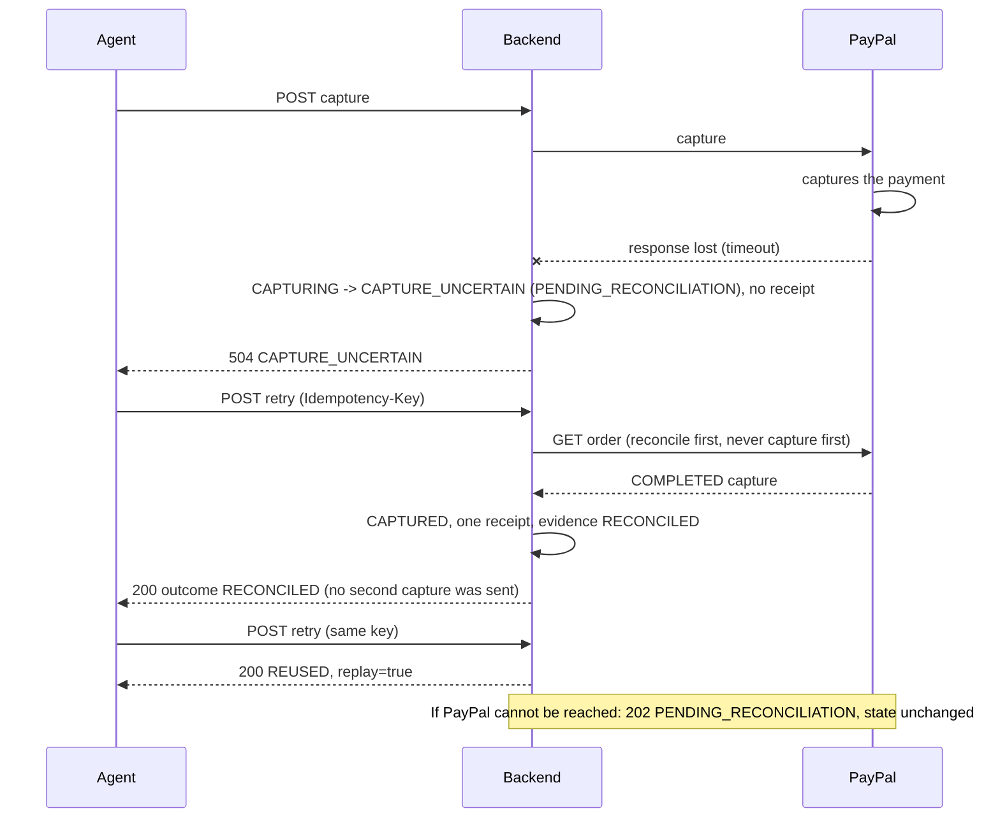
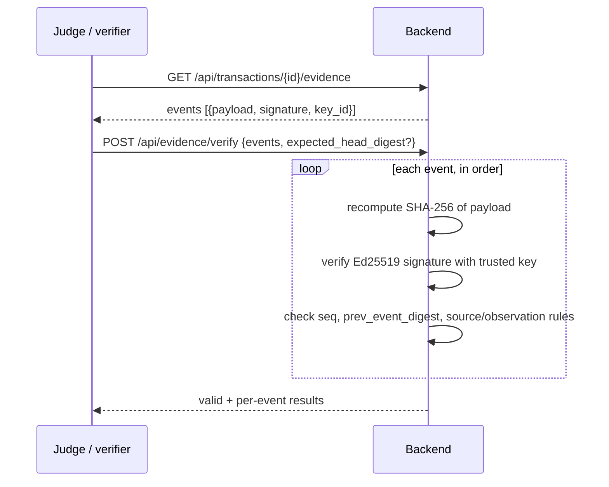
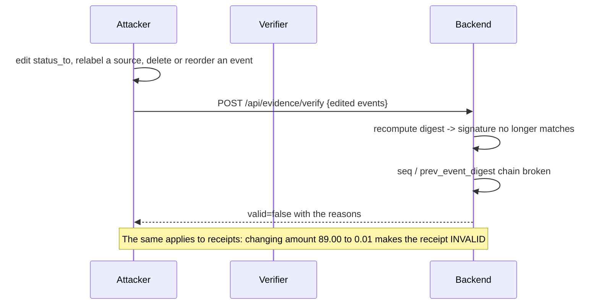

# Architecture

OutProvenance Pay is a safety and evidence layer for AI-agent payments. The rule that shapes everything:
**the AI suggests, the deterministic backend decides, a human approves, PayPal confirms the money.**

Related: [PAYPAL_INTEGRATION.md](PAYPAL_INTEGRATION.md) · [AI_USAGE.md](AI_USAGE.md) · [THREAT_MODEL.md](THREAT_MODEL.md) ·
[KNOWN_LIMITATIONS.md](KNOWN_LIMITATIONS.md)

## 1. System context

```mermaid
flowchart LR
    U[User / approver] -->|browser| FE[React frontend<br/>view only, no secrets]
    FE -->|JSON over HTTP| BE[FastAPI backend<br/>policy, approvals, signing, payments]
    BE -->|redacted text only| AI[(Optional AI provider<br/>OpenAI-compatible)]
    BE -->|server-side OAuth + Orders v2| PP[(PayPal Sandbox)]
    BE --> DB[(SQLite<br/>backend/data)]
    BE --> K[(Ed25519 key files<br/>backend/data/keys)]
    U -.buyer approval on paypal.com.-> PP
```

## 2. Component responsibilities

| Component | Responsibility | Never does |
|-----------|----------------|------------|
| Frontend (`frontend/`, React + TypeScript + Vite) | Show state, send product IDs and button presses | Decide, price, approve or confirm payment; hold secrets |
| API routers (`backend/app/api/`) | Thin HTTP layer, turn `TxError` into JSON errors | Contain business rules |
| Privacy filter (`services/privacy.py`) | Redact emails, phone numbers, card-like numbers | Guarantee all PII is removed (best-effort regex) |
| AI (`services/ai.py`) | Suggest one catalogue product id | Set price, pick seller, decide policy, approve, sign, capture |
| Catalogue (`services/catalogue.py`) | The only source of price and seller | Accept client-supplied prices |
| Manifest (`services/manifest.py`) | Build, store and verify the signed agent manifest | Trust an unsigned or edited manifest |
| Policy engine (`services/policy.py`) | ALLOW / REQUIRE_APPROVAL / DENY from fixed rules | Use AI or client input to decide |
| Transactions (`services/transactions.py`) | Intent state machine, approvals, `assert_payable` | Skip re-validation before money moves |
| Payments (`services/payments.py`, `paypal.py`) | Create and capture the PayPal order, reconcile | Mark success without PayPal's API saying so |
| Recovery (`services/recovery.py`, `attempts.py`) | Safe agent retries, persisted attempts | Re-send a capture before checking PayPal |
| Receipts (`services/receipts.py`) | Signed receipts, independent verification | Issue a payment receipt without a confirmed capture |
| Evidence (`services/evidence.py`) | Signed, hash-linked event chain, verification | Claim a valid signature means a claim is true |
| Crypto (`services/crypto.py`) | Canonical JSON, SHA-256, Ed25519, `KeyStore` | Float values in signed data |
| Attack Lab (`services/attack_lab.py`, `mock_paypal.py`) | Real attacks on a disposable copy with a mock PayPal | Touch real data, keys or PayPal |

## 3. Trust boundaries



1. **Browser -> backend.** Untrusted. It can send any JSON, replay and duplicate requests.
2. **AI -> backend.** Output is untrusted input. Input to the AI is redacted text only.
3. **Backend <-> PayPal.** PayPal's server API is the only source of truth for payment status. A browser redirect back from PayPal is **not** proof of payment.
4. **Backend <-> disk.** Keys and the database live in `backend/data/` (git-ignored). Disk access means key compromise.

## 4. Frontend / backend separation

The frontend (`services/api.ts` is its single typed client; base URL from `VITE_API_BASE_URL`) sends IDs and button
presses. Prices, sellers, decisions, approval validity, payment status, signatures and evidence all come from the
backend. There is no PayPal SDK, client ID, secret or policy logic in the browser. Pages: Overview,
Rogue Agent, Product Catalogue, Purchase Request, Privacy Preview, Agent Verification, Policy Decision, Approval,
PayPal Checkout, Recovery & Evidence, Receipt Verification, Attack Lab.

## 5. The AI boundary

The AI receives only redacted text and may return only `{product_id, rationale}`. The reply is validated with a strict
schema (`extra="forbid"`) and the id must exist in the trusted catalogue. A valid suggestion then goes through the same
policy engine as any other request. Details in [AI_USAGE.md](AI_USAGE.md).

## 6. Policy engine

Constants in `backend/app/config.py` (`POLICY_VERSION = policy-2026.1`):

| Rule | Result |
|------|--------|
| amount <= 75.00 USD | `ALLOW` |
| 75.00 < amount <= 100.00 USD | `REQUIRE_APPROVAL` |
| amount > 100.00 USD | `DENY` (`OVER_LIMIT`) |
| unknown product / unapproved seller / non-USD currency | `DENY` |
| client claims a different price or seller than the catalogue | `DENY` (`AMOUNT_MISMATCH`, `SELLER_MISMATCH`) |

## 7. Human approval

`POST /api/transactions/{id}/approve` takes the digest the approver reviewed. The backend recomputes the digest from
current trusted data; a mismatch is 409. An approval row stores the digest, policy version, `expires_at` (600 s by
default) and `used_at`. The digest covers intent id, agent id, manifest digest, product id and name, seller, amount,
currency, policy version and decision, so changing any of them invalidates the approval. Consuming an approval is an
atomic `UPDATE ... WHERE used_at IS NULL`; only one caller can win.

## 8. PayPal communication

All PayPal calls are made by `services/paypal.py` from the backend. Details, flows and idempotency are in
[PAYPAL_INTEGRATION.md](PAYPAL_INTEGRATION.md).

## 9. Data model (SQLite, SQLAlchemy)



| Table | Notes |
|-------|-------|
| `products`, `approved_sellers` | Seeded fixed catalogue (7 products, 3 approved sellers). Money in integer cents. |
| `agent_manifests` | Payload and signature in **separate columns** so tampering with either is detectable. |
| `transaction_intents` | Server-generated intent with `details_digest`, state, PayPal order/capture ids. |
| `approvals` | Digest, policy version, expiry, `used_at`. |
| `payment_attempts` | Operation, idempotency key, outcome, PayPal refs, timestamps. Unique `(intent_id, client_key)`. |
| `evidence_events` | Payload, signature, key id, digest. Unique `(intent_id, seq)`. |
| `receipts` | Payload, signature, key id, digest. Unique `(intent_id, receipt_type)`. |

Validity is never stored. Receipts, manifests and evidence are always re-verified from their content.

## 10. Transaction states



Transitions are single-statement `UPDATE ... WHERE state IN (...)`; the caller that updates one row wins and the rest
get 409. `CAPTURE_UNCERTAIN` is exposed to clients as `recovery_status: PENDING_RECONCILIATION`.

## 11. Recovery behaviour

`POST /api/transactions/{id}/paypal/retry` (requires an `Idempotency-Key` header, 8-100 characters):

| Stored state | Action |
|--------------|--------|
| `CAPTURED` | Return the original result. Nothing is sent to PayPal. |
| `CAPTURING` / `ORDER_CREATING` | Refuse as a duplicate (409). |
| `CAPTURE_UNCERTAIN` | Reconcile with PayPal. Completed -> `CAPTURED`. No capture -> capture once with the same `PayPal-Request-Id`. Cannot ask / inconclusive -> HTTP 202 `PENDING_RECONCILIATION`. |
| `READY_FOR_PAYMENT` | Create the order again with the same `PayPal-Request-Id`; PayPal returns the original order. |
| `ORDER_CREATED` | Capture (idempotent). |

If the retry body names a different product, seller, amount or currency, it is rejected (409
`RETRY_DETAILS_MISMATCH`) and any unused approval is revoked. A repeated `Idempotency-Key` is a replay and is not
re-executed.

## 12. Receipt creation

A `PAYMENT_CONFIRMED` receipt is issued only when the intent is `CAPTURED`, has a PayPal capture id, and PayPal's
status was `COMPLETED`. Otherwise only a `DEV_TEST_NO_PAYMENT` receipt exists, labelled as claiming no payment.
The payload includes `evidence_reference` (chain head at issue time). The payload is canonicalised, signed with the
`receipt-signer` key and stored. Verification (`POST /api/receipts/verify`) recomputes the digest from the submitted
content, checks the signature against trusted keys, and runs consistency checks (for example a payment receipt that
lacks a capture id is invalid even if correctly signed).

## 13. Evidence-chain construction

Each lifecycle step appends one event for the intent. Fields: `schema` (`opp-evidence/1`), `event_id`, `intent_id`,
`seq`, `event_type`, `source` (`PAYPAL_OBSERVED` or `INTERNAL`), `recorded_at`, `prev_event_digest`, `refs`
(approval id, details digest, attempt id, idempotency key, PayPal order/capture ids, receipt id), `status_from`,
`status_to`, `paypal_observation`, `claim_basis`, `note`. The digest of an event is SHA-256 of its canonical JSON;
the next event stores it as `prev_event_digest`; the event is signed with the `evidence-signer` key.
`PAYPAL_OBSERVED` events carry what PayPal's API actually returned; `INTERNAL` events are the application's own
records and must not carry a PayPal observation (verification enforces both).

This is **TRACE-inspired**. It is not a conformant TRACE or SCITT implementation.

## 14. Cryptographic signing

- Canonical JSON: UTF-8, sorted keys, separators `(",", ":")`, no NaN, **floats rejected** (money is a string).
- Digest: SHA-256. Signature: Ed25519 (`cryptography`). Key id: `ed25519:` + first 16 hex characters of SHA-256 of the raw public key.
- Three keys generated on first start in `backend/data/keys/`: `manifest-issuer`, `receipt-signer`, `evidence-signer`.
- Development key handling only. Rotation: stop the backend, delete the `*.private.pem`, restart (new key id). Old signatures then no longer verify because the old key leaves the trust set; delete `backend/data/` in development to regenerate everything. A real deployment needs a KMS/HSM, a registry that keeps retired key ids for verifying history, and revocation.

## 15. Verification process

- Receipt: `POST /api/receipts/verify` with `{payload, signature_b64, key_id}`.
- Evidence: `POST /api/evidence/verify` with `{events: [...], expected_head_digest?}`. Per event: signature, required fields, schema, source/observation consistency, `seq` equals position, `prev_event_digest` equals the previous recomputed digest, no duplicate ids, same intent. With `expected_head_digest` (for example the receipt's `evidence_reference.head_digest`), removal of the pinned point is also detected.
- A standalone script, `backend/verify_receipt.py`, verifies a downloaded receipt with only the `cryptography` package.

A valid signature proves the content is unchanged since a trusted key signed it. It does not prove the claims are
true, the signer's real-world identity, or that goods were delivered.

## 16. Failure scenarios

| Failure | Behaviour |
|---------|-----------|
| PayPal credentials missing | 503 `PAYPAL_NOT_CONFIGURED`; nothing attempted |
| PayPal declines capture | `FAILED`, no receipt |
| Timeout / 5xx on capture | `CAPTURE_UNCERTAIN`; blind capture refused; reconcile or retry resolves it |
| Response lost after PayPal captured | Same as above; reconcile finds `COMPLETED`; one capture, one receipt |
| PayPal unreachable during reconcile | Stays uncertain; 202 `PENDING_RECONCILIATION` from the retry endpoint |
| Price/seller changed after approval | `DETAILS_CHANGED`; approval invalid; no order |
| Approval expired or already used | `APPROVAL_EXPIRED` / `APPROVAL_REPLAYED` |
| Two requests race | One wins an atomic state claim; the other gets 409 |
| Manifest edited | Signature fails; every purchase blocked (`MANIFEST_INVALID`) |

## 17. Sequence diagrams

### 17.1 Normal purchase (ALLOW)



### 17.2 Purchase that needs human approval



### 17.3 Denied purchase



### 17.4 Successful PayPal capture



### 17.5 Lost PayPal response and recovery



### 17.6 Evidence verification



### 17.7 Tamper detection



## 18. Attack Lab design

Each run builds a disposable app (temporary SQLite, throwaway keys, in-memory fake PayPal), drives it over its HTTP
API, then deletes it. Fixtures that an attack alters (manifest payload, prices, approval expiry) are restored inside
that sandbox; the real database, keys and PayPal account are never touched. PASS or FAIL is computed from observed
responses. Tests deliberately break a defense and assert that the lab reports FAIL.
